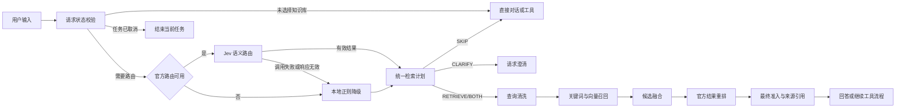

# PetDock 知识库增强官方能力方向

版本：0.3
更新日期：2026-10-26
状态：Draft（核心链路已本地实现，真实联调、灰度评测与公平预算待完成）
适用范围：PetDock Desktop、PetDock Cloud、PetDock Web

## 1. 文档目的

本文档定义知识库相关官方能力的产品形态、额度模型、运行边界和实施顺序。它记录 Cloud 契约、官方数据面、Desktop Runtime、桌面设置页和官网用量展示的开发方向及实施边界。

本文档是产品化方向，不替代 `petdock-cloud/contracts/managed-service/v1` 的权威契约。正式修改 API、Token Claims、能力枚举、用量事件或错误码前，必须先在 Cloud 仓库完成契约评审和契约测试，再同步 Desktop 消费快照。

## 2. 背景与问题

当前 RAG 管线已经包含检索前路由、文本向量召回和候选结果重排，但这些能力在实现和设置层面分散存在：

- 本轮已接入官方 Jev 路由：可用时独立完成语义判断，不可用或调用失败时降级到本地正则；本地与 BYOK 保留原有规则路径。服务端默认关闭，尚未发布。
- 文本向量用于知识库建库和查询召回，已经可以使用本地、BYOK 或官方 Provider。
- 重排用于候选融合后的相关性校准，属于知识库回答质量的一部分。
- 用户不需要理解 `RAG`、`Embedding`、`Rerank` 或模型名称，只需要知道知识库回答是否使用官方增强能力。

因此，产品侧将三类能力合并为一个“知识库增强”官方能力，并使用同一个用户可见额度；工程侧继续保留独立 Provider、用量维度和故障降级。

## 3. 产品决策

### 3.1 用户侧能力名称

桌面官方能力页只展示以下知识库能力：

```text
知识库增强    剩余 xxx Token    [开关]
```

用户界面不展示以下内部名词：

- 检索路由
- Jev
- 文本向量 / Embedding
- 结果重排 / Rerank

“知识库增强”用于说明功能价值；模型供应商、逻辑模型、单次成本和内部权重不进入普通桌面设置页。官网完整用量页可以在“知识库增强”下展开显示分类统计，但仍以用户可理解的中文描述为主。

### 3.2 能力组成

一个“知识库增强”能力由以下内部子能力组成：

```text
knowledge_base
├── route       语义路由判断
├── embedding   文档与查询向量
└── rerank      候选结果重排
```

三者属于同一个产品能力组，但不要求使用同一个上游模型，也不要求同时成功。每个子能力都必须能够独立记录状态、用量、耗时和降级原因。

### 3.3 与其他官方能力的边界

- `Chat` 仍然是回答生成能力，不并入“知识库增强”。
- `Web Search` 仍然是联网搜索能力，不并入“知识库增强”。
- `Vision` 仍然是图片理解能力，不并入“知识库增强”。
- 本地知识库、SQLite、Chroma、FTS5 和本地 Hash/ONNX Provider 仍属于本地 Runtime，不因为启用官方能力而迁移到云端。

## 4. 运行流程



### 4.1 路由调用边界

2026-10-26 确认采用“Jev 可用时只走 Jev，降级时才走正则”的策略。这里的前置校验只处理请求状态和调用条件，不判断用户文本的语义。

- 未选择知识库时跳过知识库路由；任务已取消时终止处理。不需要重新检索的工具结果续轮依据任务状态去重，不重复发起同一轮路由。
- 对需要新路由判断的请求，检查官方能力开关、配置、授权、会话和额度等调用条件。服务端仍须执行权威鉴权和额度校验，客户端状态不能代替这些检查。
- Jev 可用时，所有语义判断统一交给 Jev，包括寒暄、明确 URL、应用或文件操作、创作、资料问答和复合请求。正常路径不执行正则预筛选，不并行运行正则投票，也不在 Jev 返回后用正则覆盖结果。
- Jev 输出必须是现有 `SKIP`、`RETRIEVE`、`BOTH`、`CLARIFY` 四种结果之一，并返回置信度和选项概率等诊断信息。低置信度本身不触发正则接管；如需增加低置信度策略，应另行确认并经过评测，不把现有正则中写死的 `confidence` 作为依据。
- 官方能力关闭、未配置、授权或额度不可用，或者请求遇到网络失败、超时、限流、服务异常、响应格式错误时，才使用本地正则生成降级计划，并记录稳定的降级原因。任务取消不得触发正则继续处理。
- 同一轮只采用一个路由结果。Jev 成功时采用 Jev 结果；Jev 无法使用时采用正则降级结果。离线评测可以分别运行两种策略进行比较，线上正常请求不做双路裁决。

### 4.2 资料处理边界

- 官方向量 Provider 只接收建库或查询所需的文本片段，不获得本地文件路径、工具权限、会话 Token 或 Skill 权限。
- 官方重排 Provider 只接收查询和候选片段，不直接读取本地知识库。
- 官方路由只接收当前分类所需的用户输入和脱敏运行状态，不接收完整会话历史，除非后续契约评审明确需要。
- 召回、最终准入、来源引用和工具权限仍由本地 Runtime 控制。

## 5. 额度模型

### 5.1 用户可见额度

官方服务向用户提供一个共享额度池：

```text
knowledge_base.remaining
```

2026-10-26 用户确认：旧文本向量和结果重排剩余额度按 1:1 相加，计入共享池；V11 同时合并套餐默认额度，历史用量不改写，在途退款回到共享池。V10 保留为已有官网统计迁移。

用户只看到“知识库增强剩余额度”，不需要分别管理路由、向量和重排额度。套餐授权、额度重置和额度耗尽行为沿用现有 Managed 服务规则：额度耗尽后官方能力停止，不自动切换按量计费，也不自动改用用户的 BYOK 配置。

### 5.2 内部计量

共享额度不能导致内部观测丢失。每次官方调用至少保留以下内部维度：

| 维度 | 取值示例 | 用途 |
|---|---|---|
| 产品能力组 | `knowledge_base` | 统一授权和用户额度 |
| 操作类型 | `route`、`embedding`、`rerank` | 成本、性能和故障分析 |
| 使用场景 | `query`、`index` | 区分交互查询和后台建库 |
| 输入/输出单位 | Token 或 Provider 返回的等价单位 | 预占、结算和对账 |
| 状态 | reserved、settled、released、failed | 幂等和异常回收 |

本轮已在 Cloud 权威契约冻结 `route-standard` 与共享余额映射。现有 Usage Event 保留操作类别，但尚未新增 query/index 使用场景字段；此维度仍为后续方向，不表示本轮已实现。

Jev 成功返回 `SKIP` 或 `CLARIFY` 也属于实际路由调用，应按真实用量计量；未执行的向量和重排不产生相应用量。本地正则降级不产生新的官方模型用量；已发出的 Jev 调用仍须按现有 Usage Event 规则闭合，不能因随后使用本地结果而抹除其用量。

### 5.3 共享额度的公平性

三类调用共用一个余额。本轮继续使用独立 Provider 并发、建库小批次和单次预算限制；尚无交互查询专用额度保留比例，也没有跨请求优先队列。以下是后续预算与灰度目标，不能视为本轮已实现：

- 交互查询中的 `route` 和 `rerank` 优先于后台 `embedding` 建库任务。
- 大规模建库必须使用批次、并发和单次预算限制，不能一次占满全部额度。
- 预占失败或服务未调用时释放额度；Provider 已调用但用量未知时按现有 Usage Event 规则处理。
- 额度不足时，不影响本地知识库、FTS5、Hash 索引和确定性路由继续工作。

## 6. 降级与状态

“知识库增强”是一个产品开关，但内部子能力可以出现部分可用状态：

| 情况 | 用户侧状态 | Runtime 行为 |
|---|---|---|
| 三项均可用 | 已就绪 | 由 Jev 独立判断语义路由，按结果决定是否调用官方向量和重排 |
| 路由不可用或调用失败 | 部分可用 | 使用本地正则降级；其余能力按各自状态继续执行 |
| 向量不可用 | 部分可用 | 使用本地 Hash/FTS5 或已有本地向量空间 |
| 重排不可用 | 部分可用 | 使用确定性融合和最终准入 |
| 官方额度或授权不可用 | 未就绪 | 保留本地知识库能力，不发送官方请求 |
| 用户关闭开关 | 已关闭 | 三项官方调用均停止，继续使用本地能力 |

日志和诊断视图可以记录具体子能力及错误码；普通用户界面只展示“已就绪、部分可用、未就绪、已关闭”等状态和可操作的解释。

## 7. 跨仓实施边界

### 7.1 PetDock Cloud

- 在权威契约中定义 `knowledge_base` 产品能力组及其授权、额度和用量关系。
- 增加官方路由 Provider 的数据面适配和服务端密钥管理。
- 统一处理路由、向量和重排的预占、结算、释放、限流、超时和稳定错误。
- Usage Event 保留操作类型和使用场景，支持按产品能力汇总和内部拆分分析。
- 不向 Desktop 或 Web 下发上游 Provider Key。

### 7.2 PetDock Desktop

- 将官方能力页的文本向量、重排独立入口合并为“知识库增强”。
- Runtime 继续保留 Provider 注入、子能力状态和本地降级。
- 在 `retrieve_sources` 入口接入官方路由。状态校验后，Jev 可用时由 Jev 独立完成语义路由，正则仅用于降级。
- 对每次路由调用记录脱敏耗时、模型版本、状态和降级原因，不记录用户正文或 API Key。
- 关闭、未授权、超时和额度不足不得阻断本地 RAG。

### 7.3 PetDock Web

- 套餐和能力管理以“知识库增强”为用户授权单元。
- 用量页展示共享额度和按操作类型的可选明细。
- 充值、套餐和正式按量计费规则继续遵循现有支付与账单评审流程。

## 8. 兼容策略

第一阶段不立即从协议中删除现有 `embedding`、`rerank` 等内部字段。新客户端使用 `knowledge_base` 聚合用户体验，同时继续消费内部子能力状态；旧客户端保持原有字段和行为。

如果后续需要把协议层也完全收敛为单一能力，必须新建兼容版本或完成可验证的向后兼容扩展，不能直接改变现有 v1 枚举、必填字段或 Usage Event 语义。

Cloud 的 `contracts/managed-service/v1` 仍是唯一权威源。Desktop 和 Web 只能消费已验证的契约快照，不在各自仓库独立扩展能力枚举。

## 9. 实施阶段

### KB-0：方向与契约评审

- 确认产品能力名称、共享额度、子能力状态和降级语义。
- 冻结 Token/单位换算、建库与查询预算、公平性和隐私提示。
- 在 Cloud 权威契约中完成能力组、Usage Event 和 Runtime Claims 评审。

### KB-1：Cloud Provider 与额度

- 接入官方路由 Provider。
- 建立 `knowledge_base` 共享额度的预占、结算和释放。
- 为 `route`、`embedding`、`rerank` 建立独立的内部观测和故障映射。

### KB-2：Desktop Runtime

- 拆分请求状态校验与语义路由；Jev 可用时直接采用其结果，仅在不可用或调用失败时进入正则降级。
- 验证正常路径不调用正则、故障路径仅采用一次降级结果，任务取消和无需重复路由的续轮不触发额外判断。
- 注入官方向量和重排 Provider。
- 完成本地降级、超时、取消、额度不足和旧客户端兼容。

### KB-3：产品界面与官网

- Desktop 统一显示“知识库增强”开关、状态和剩余额度。
- Web 统一显示能力授权和共享额度，保留可选的内部用量明细。
- 删除普通设置页中面向用户的 Embedding/Rerank 技术术语。

### KB-4：评测与灰度

- 分别评测正则基线、Jev 正常路径和正则降级路径的路由准确率、误检索率、P50/P95 延迟与用量；不将正则预筛选或双路投票作为目标策略。
- 验证不同规模知识库的建库额度、公平调度和失败释放。
- 先小范围灰度，再决定是否默认开启官方知识库增强。

## 10. 验收标准

- 用户只需理解一个“知识库增强”能力即可完成授权和开关操作。
- 路由、向量和重排共享用户额度，但每项调用可独立审计和对账。
- 官方任一子能力不可用时，本地知识库仍可用，且不会静默发送到未授权 Provider。
- 已选择知识库、需要新路由且 Jev 可用时，明确工具请求、寒暄和资料问题均由 Jev 判断，正则语义路由的调用次数必须为零。
- 未选择知识库、任务取消和无需重复路由的续轮不产生新的 Jev 调用；任务取消也不得转入正则处理。
- Jev 不可用、超时或响应无效时进入正则降级；有效的低置信度结果不被正则覆盖，降级原因和实际用量可追踪。
- 建库任务不能无限占用交互查询额度，额度预占和释放具备幂等性。
- 旧版 Desktop 在新增能力字段或状态缺失时仍能启动并使用原有本地/BYOK 流程。
- 日志、Usage Event 和错误提示不包含 API Key、Token、Cookie、用户正文、附件正文或绝对路径。
- 固定评测集证明官方路由相对当前规则在准确率或误检索率上有可接受收益，且额外延迟和用量在已确认预算内。

## 11. 本轮实施与剩余验收

已本地实现 KB-0 的路由/额度契约、KB-1 的 Provider 与共享扣款退款、KB-2 的独立路由及正则降级、KB-3 的统一入口与官网展示。Cloud v1 继续保留旧偏好及余额别名，未部署、未发布安装包；源码提交状态见[进度记录](../roadmap/MANAGED_SERVICE_PROGRESS.md)。

- 路由上游固定采用用户指定的 `https://api.xrrii.xyz`，路径 `/v1/systemone`；默认模型别名 `jev-latest` 可由服务端配置。Secret 仅服务端读取，空 Secret 保持不可用。
- 计量不按价格加权：向量/重排沿用原字符等价单位，Jev 使用上游 input/output tokens，按 1:1 扣同一池。迁移后知识库增强最大余额为 40 亿，其他能力仍为 20 亿。
- 三项部署开关仍独立，客户端用户开关一次更新旧 embedding/rerank 偏好；服务端将产品授权展开为三个操作 Claims。旧服务端展示做两项相加，新服务端共享字段优先，避免重复计算。
- 已覆盖有效低置信度、四种路由、无库/续轮跳过、取消、超时、无效响应、可靠用量结算、排队取消释放、未授权无预占与旧字段兼容。
- KB-4 仍待真实 Jev、真实模型路由质量与延迟/用量评测、数据库迁移执行及安装版验收；当前无真实上游 Key 调用，Docker 不可用导致 PostgreSQL/Testcontainers 场景跳过，不据此声明迁移实际验证通过。
- 公平调度所需 query/index 用量维度、交互保留额度及跨请求优先策略仍待预算冻结。当前批次和并发限制不能保证后台建库不会最终耗尽共享余额。

Cloud 配置与数据库升级步骤见该仓库 `docs/guides/KNOWLEDGE_BASE_ENHANCEMENT.md`；当前验证事实与契约快照来源见 [官方服务进度](../roadmap/MANAGED_SERVICE_PROGRESS.md)。

## 12. 相关基线

- [RAG 检索优化方案](RAG_RETRIEVAL_OPTIMIZATION.md)
- [Managed Service 双模式实施方案](../architecture/MANAGED_SERVICE_IMPLEMENTATION_PLAN.md)
- [Managed Service Provider 盘点](../architecture/MANAGED_SERVICE_PROVIDER_INVENTORY.md)
- [Managed Service 当前进度](../roadmap/MANAGED_SERVICE_PROGRESS.md)
- [Managed Service v1 权威契约](../../../petdock-office/petdock-cloud/contracts/managed-service/v1/README.md)
